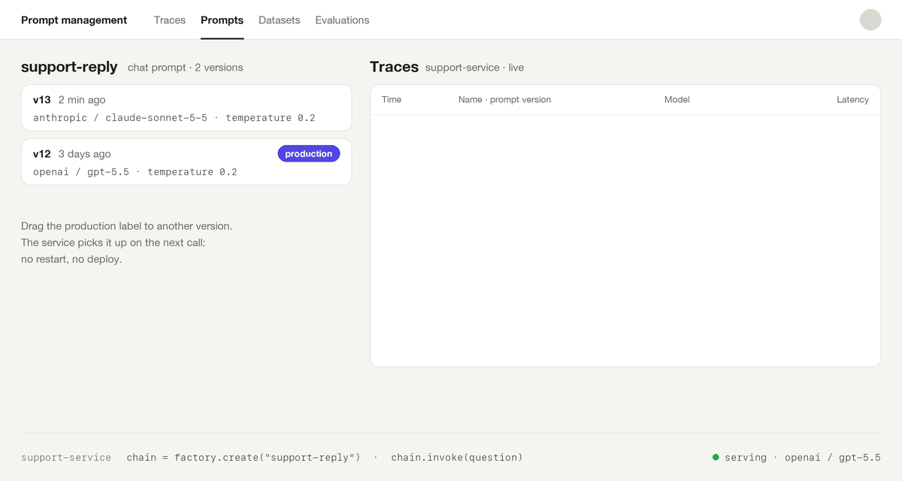

# langfuse-hotswap

*Горячая замена языковой модели в цепочке LangChain через промпт Langfuse.*

[](https://pypi.org/project/langfuse-hotswap/)
[](https://pypi.org/project/langfuse-hotswap/)
[](https://github.com/rusih100/langfuse-hotswap/actions/workflows/ci.yml)
[](https://github.com/rusih100/langfuse-hotswap/blob/main/LICENSE)

[English](README.md) | **Русский**

**Документация**: <https://rusih100.github.io/langfuse-hotswap/ru/>

<p align="center">
  
</p>

Управление промптами в [Langfuse](https://langfuse.com) выносит шаблон из кода: его правят в
интерфейсе, а сервис забирает актуальную версию. Модель при этом остаётся в коде — `gpt-5.5`,
`temperature=0.2` прописаны рядом с цепочкой, и любое их изменение требует деплоя.

`langfuse-hotswap` переносит модель в конфигурацию промпта. Библиотека предоставляет обычный
[LangChain](https://github.com/langchain-ai/langchain) `Runnable`: при каждом вызове он получает
промпт, собирает по его конфигурации цепочку `template | model` и пересобирает её, когда промпт
меняется. Версия промпта объединяет шаблон, модель и параметры — они получают метку, выкатываются и
откатываются как единое целое.

- **Любой провайдер**, поддерживаемый `init_chat_model`: OpenAI, Anthropic, Google, Mistral,
  Ollama и другие.
- **Безопасность по умолчанию.** Из конфигурации берутся только параметры генерации. Адреса,
  ключи, заголовки и HTTP-клиенты из неё не читаются никогда. Настройки в коде имеют приоритет.
- **Устойчивость к сбоям.** Если новая версия не собирается или Langfuse недоступен, продолжает
  работать последняя исправная цепочка.
- **Полноценный `Runnable`.** `invoke`, `stream`, `batch` и их асинхронные варианты,
  `with_structured_output`, `bind_tools`, композиция с другими runnable.
- **Асинхронность без блокировок.** Прогретый кеш SDK читается в цикле событий, HTTP-запросы
  выполняются в пуле потоков.
- **Трассировка привязана к версии промпта.**

## Установка

```shell
pip install langfuse-hotswap langchain-openai
```

## Пример

Создайте в Langfuse чат-промпт `support-reply`, присвойте ему метку `production` и задайте
конфигурацию:

```json
{"model": "gpt-5.5", "model_provider": "openai", "temperature": 0.2, "max_tokens": 800}
```

```python
from langfuse import get_client
from langfuse_hotswap import LangfuseChainFactory

factory = LangfuseChainFactory(get_client())
chain = factory.create("support-reply")

message = chain.invoke({"product": "Acme Mail", "language": "English", "question": "How do I reset my password?"})
print(message.content)
```

Теперь создайте новую версию промпта с параметрами `"model": "claude-sonnet-5-5",
"model_provider": "anthropic"` и перенесите на неё метку `production`. Следующий вызов `invoke`
уйдёт в Anthropic. Верните метку обратно — и запросы снова пойдут в OpenAI. Без перезапуска и без
деплоя.


## Границы доверия

Конфигурацией промпта управляет каждый, кто может его редактировать. Насколько далеко простирается
это право, решает код:

```python
factory = LangfuseChainFactory(
    get_client(),
    timeout=30,  # имеет приоритет над конфигурацией
    providers={"openai": {...}, "anthropic": {...}},  # конфигурация может выбрать только одного из них
    allowed_config_keys={"model", "model_provider", "temperature", "max_tokens"},
)
```

`base_url`, `api_key`, заголовки, прокси и подобные параметры не попадают в модель ни при каких
настройках белого списка. Провайдер никогда не определяется по имени модели. Подробнее — в разделе
[Безопасность](https://rusih100.github.io/langfuse-hotswap/ru/security/).

## Что дальше

- [Как это работает](https://rusih100.github.io/langfuse-hotswap/ru/how-it-works/): получение промпта, сравнение, пересборка, асинхронный путь.
- [Конфигурация](https://rusih100.github.io/langfuse-hotswap/ru/configuration/): источники параметров, метки и версии.
- [Настройка модели](https://rusih100.github.io/langfuse-hotswap/ru/customizing/): хуки, структурированный вывод, инструменты.
- [Обработка ошибок](https://rusih100.github.io/langfuse-hotswap/ru/errors/) и [шаблоны](https://rusih100.github.io/langfuse-hotswap/ru/templates/).
- [`examples/`](examples/): короткие скрипты, по одному на каждую возможность.

Неофициальный проект, не связанный с Langfuse и LangChain. Лицензия MIT.
