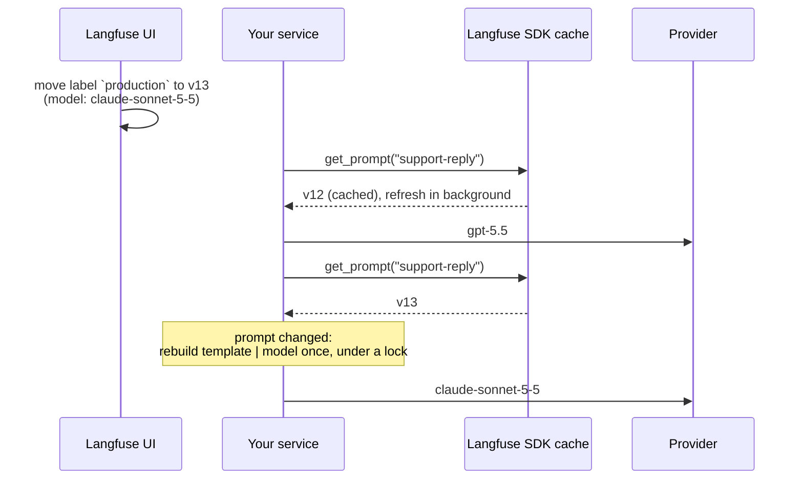

# How it works

Every call does three things:

1. **Fetch** the prompt through `client.get_prompt(...)`. The Langfuse SDK caches prompts and
   refreshes them in the background, so this is a dict lookup most of the time. Async methods
   fetch on the event loop once a chain is built from a prompt that came from Langfuse: the SDK
   then answers from its cache without blocking, even when the entry is stale. The first call,
   `cache_ttl_seconds=0`, a chain built from `fallback` and the calls after a failed fetch go to
   the executor instead, because there the SDK fetches over HTTP. A rebuild always runs in the
   executor. One case still blocks the loop for a single fetch: the SDK cache entry was dropped,
   because the prompt was deleted in Langfuse or a prompt was updated through the same client. An
   update drops the entries of every prompt whose name starts with the updated name, so updating
   `support` also drops `support-reply`.
2. **Compare** it with the prompt the current chain was built from. The SDK returns the same
   object until it refreshes the prompt, so most calls stop at an identity check. Otherwise prompts
   are compared by name, version, content and config. The version number alone would not do,
   because Langfuse gives a new prompt the number of a deleted latest version.
3. **Delegate** to the chain. If the prompt changed, the chain is rebuilt first: the model is
   created with `init_chat_model`, the hooks are applied, the template is built and
   `template | model` is cached. The rebuild runs under a lock, so concurrent callers build it
   once, and calls that arrive during the rebuild are served by the previous chain.

The runnable itself holds no model, only a chain for the current prompt. That is why it should be
created once and reused: a chain created inside a request handler rebuilds the model on every
request.

## Limitations

- A model change in Langfuse changes production without a commit. Guard the production label.
- The output schema and the prompt variables are not versioned with the prompt.
- Until the SDK cache TTL expires, replicas may run different prompt versions.
- `copy` and `deepcopy` share the client and the hooks and start with an empty cache. Pickling is
  not supported.

## The contract with the Langfuse SDK

The library relies on behavior of the Langfuse SDK that its public API does not promise: the
fields of the prompt client, that a fresh cache entry is served as the same object, that a stale
one is served at once while the refresh runs in the background, and the rendering rules.
`tests/test_sdk_contract.py` pins each of these against a real client with a stubbed HTTP API, so
a change in the SDK fails the build instead of changing the behavior silently. CI runs the suite
on the lowest supported `langfuse` and on the locked version; a nightly workflow runs it on the
latest `langfuse` 5.x release.
