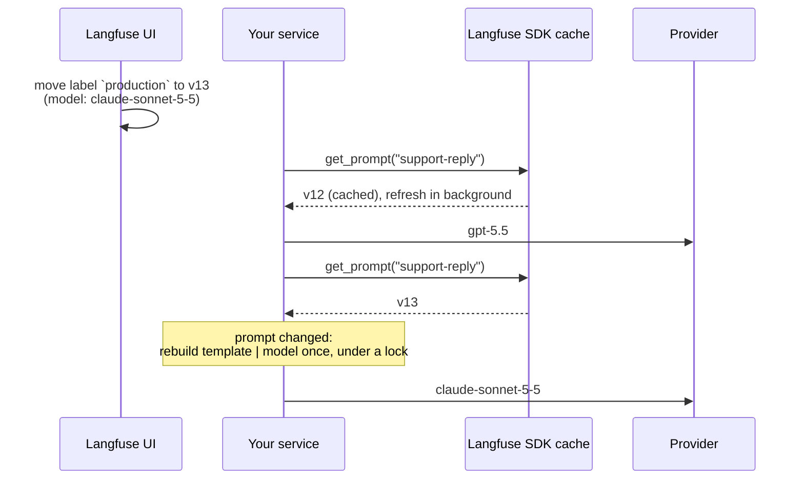

# How it works

Every call does three things:

1. **Fetch** the prompt through `client.get_prompt(...)`. The SDK caches prompts and refreshes them
   in the background, so this is a dict lookup most of the time.
2. **Compare** it with the prompt the current chain was built from. The SDK returns the same
   object until it refreshes the prompt, so most calls stop at an identity check. Otherwise prompts
   are compared by name, version, content and config. The version number alone would not do,
   because Langfuse gives a new prompt the number of a deleted latest version.
3. **Delegate** to the chain. If the prompt changed, the chain is rebuilt first: the model is
   selected from `models` by `provider`, the allowed config keys are applied, the hooks run, the
   template is built and `template | model` is cached. The rebuild runs under a lock: concurrent
   callers build once, and calls that arrive during a rebuild are served by the previous chain.

The fetch, the comparison and the rebuild live in `PromptManager`; the runnable adds the hooks and
the chain. A runnable holds one chain, for the current prompt, so create it once and reuse it: a
chain created inside a request handler rebuilds on every request.

## Failures

A version that fails to build is logged once and not retried until the prompt changes; the
previous chain keeps serving. A failed fetch is logged once per outage, and the previous chain
keeps serving. Without a previous chain both are raised. See [Error handling](errors.md).

## Async

Async methods fetch on the event loop once a chain is built from a prompt that came from Langfuse:
the SDK then answers from its cache without blocking, even when the entry is stale. The first call,
`cache_ttl_seconds=0` and the calls after a failed fetch go to the executor instead, because there
the SDK fetches over HTTP. A rebuild always runs in the executor. One case still blocks the loop
for a single fetch: the SDK cache entry was dropped, because the prompt was deleted in Langfuse or
a prompt was updated through the same client. An update drops the entries of every prompt whose
name starts with the updated name, so updating `support` also drops `support-reply`.

## Limitations

- A model change in Langfuse changes production without a commit. Guard the production label.
- The output schema and the prompt variables are not versioned with the prompt.
- Until the SDK cache TTL expires, replicas may run different prompt versions.
- `copy` and `deepcopy` share the client and the hooks and start with an empty cache. Pickling is
  not supported.

## Compared with the SDK alone

The Langfuse SDK gives you `get_prompt()` and `prompt.get_langchain_prompt()`. Reading
`prompt.config["model"]` and building a model from it is a few lines. The rest is what the few
lines leave out:

| | By hand | `langfuse-hotswap` |
|---|---|---|
| Model follows the prompt version | You write it | Yes |
| Rebuild only when the prompt changes | You cache the model and compare prompts | Identity check, then name, version, content and config |
| Concurrent calls during a rebuild | You take a lock | Built once; callers are served by the previous chain |
| New version fails to build | Every call fails | Previous chain keeps serving, retried when the prompt changes |
| Langfuse unreachable, cache empty | `get_prompt` raises | `PromptFetchError`; with a built chain it keeps serving |
| Prompt editor sets `base_url` or `api_key` | Reaches the model constructor | Only the allowed keys reach it, none by default |
| Prompt editor switches provider | Whatever is installed | Only the models the code built, by name |
| `ainvoke` on a cold SDK cache | Blocks the event loop on HTTP | Runs in the executor; a warm cache is served on the loop |
| Rendering | `get_langchain_prompt()` rewrites `{{x}}` to `{x}` and escapes braces | Langfuse rules, placeholders, missing variable is an error; f-string, mustache and jinja2 on request |
| Structured output, tools, retries | Rebuilt with the model | Hooks applied on every rebuild |
| Trace linked to the prompt version | You pass the prompt in metadata | Attached to every run |
