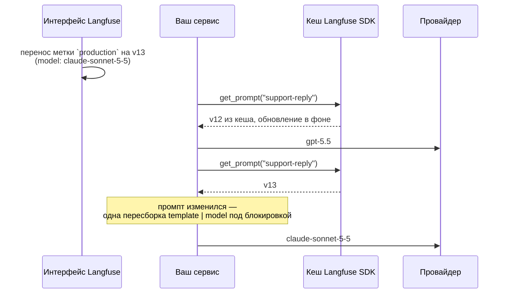

# Как это работает

Каждый вызов проходит три шага.

1. **Получение промпта** через `client.get_prompt(...)`. SDK Langfuse кеширует промпты и
   обновляет их в фоновом режиме, поэтому в большинстве случаев это обычное чтение из словаря.
   Асинхронные методы обращаются к SDK прямо в цикле событий, как только цепочка собрана из
   промпта, полученного от Langfuse: SDK отвечает из кеша без блокировки, даже если запись
   устарела. В пул потоков уходят первый вызов, вызовы при `cache_ttl_seconds=0`, цепочка,
   собранная из `fallback`, и вызовы после неудачного получения промпта — во всех этих случаях SDK
   обращается к серверу по HTTP. Пересборка цепочки всегда выполняется в пуле потоков. Остаётся
   один случай, когда цикл событий блокируется на время одного запроса: запись удалена из кеша SDK,
   потому что промпт удалили в Langfuse или какой-либо промпт обновили через тот же клиент. При
   обновлении удаляются записи всех промптов, имя которых начинается с имени обновлённого, поэтому
   обновление `support` сбрасывает и `support-reply`.
2. **Сравнение** с промптом, из которого собрана текущая цепочка. Пока SDK не обновит промпт, он
   возвращает тот же объект, поэтому большинство вызовов ограничивается проверкой идентичности. В
   остальных случаях промпты сравниваются по имени, версии, содержимому и конфигурации. Одного
   номера версии недостаточно: Langfuse присваивает новому промпту номер удалённой последней
   версии.
3. **Передача вызова цепочке.** Если промпт изменился, цепочка сначала пересобирается: через
   `init_chat_model` создаётся модель, к ней применяются хуки, собирается шаблон, и готовая
   цепочка `template | model` кешируется. Пересборка выполняется под блокировкой, поэтому
   параллельные вызовы собирают цепочку один раз, а запросы, поступившие во время пересборки,
   обслуживает предыдущая цепочка.

Сам runnable не хранит модель — только цепочку для текущего промпта. Поэтому его следует создавать
один раз и использовать повторно: цепочка, созданная внутри обработчика запроса, будет пересобирать
модель при каждом запросе.

## Ограничения

- Смена модели в Langfuse меняет поведение в эксплуатации без коммита. Ограничьте доступ к метке
  `production`.
- Схема вывода и переменные промпта не версионируются вместе с промптом.
- Пока не истёк срок жизни кеша SDK, разные реплики сервиса могут работать с разными версиями
  промпта.
- `copy` и `deepcopy` разделяют клиент и хуки с оригиналом и начинают с пустым кешем. Сериализация
  через pickle не поддерживается.

## Контракт с Langfuse SDK

Библиотека опирается на поведение Langfuse SDK, которое не гарантировано его публичным API: набор
полей промпт-клиента, возврат одного и того же объекта, пока запись в кеше свежая, немедленная
выдача устаревшей записи с обновлением в фоне, а также правила подстановки переменных. Модуль
`tests/test_sdk_contract.py` закрепляет каждое из этих допущений тестом против настоящего клиента с
подменённым HTTP API: изменение в SDK приведёт к падению сборки, а не к незаметной смене
поведения. CI запускает тесты на минимальной поддерживаемой версии `langfuse` и на версии из
lock-файла; ночной workflow проверяет последний выпуск `langfuse` 5.x.
