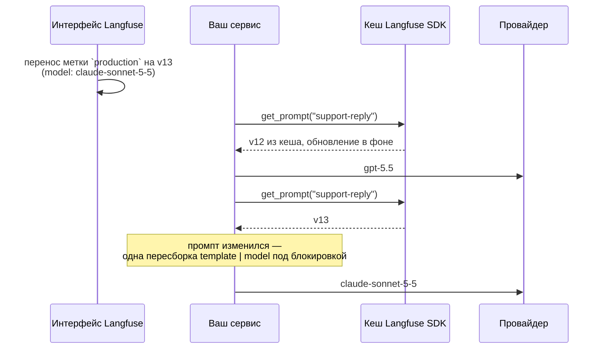

# Как это работает

Каждый вызов проходит три шага.

1. **Получение промпта** через `client.get_prompt(...)`. SDK кеширует промпты и обновляет их в
   фоновом режиме, поэтому в большинстве случаев это обычное чтение из словаря.
2. **Сравнение** с промптом, из которого собрана текущая цепочка. Пока SDK не обновит промпт, он
   возвращает тот же объект, поэтому большинство вызовов ограничивается проверкой идентичности. В
   остальных случаях промпты сравниваются по имени, версии, содержимому и конфигурации. Одного
   номера версии недостаточно: Langfuse присваивает новому промпту номер удалённой последней
   версии.
3. **Передача вызова цепочке.** Если промпт изменился, цепочка сначала пересобирается: по ключу
   `provider` выбирается модель из `models`, к ней применяются разрешённые ключи конфигурации,
   затем хуки, собирается шаблон, и готовая цепочка `template | model` кешируется. Пересборка
   выполняется под блокировкой: параллельные вызовы собирают цепочку один раз, а запросы,
   поступившие во время пересборки, обслуживает предыдущая цепочка.

Получение промпта, сравнение и пересборка живут во внутреннем менеджере промпта; runnable добавляет к ним хуки и
цепочку. Runnable хранит одну цепочку — для текущего промпта, — поэтому создайте его один раз и
используйте повторно: цепочка, созданная внутри обработчика запроса, будет пересобираться при
каждом запросе.

## Сбои

Версия, которая не собирается, записывается в журнал один раз и не пробуется заново, пока промпт не
изменится; предыдущая цепочка продолжает работать. Неудачное получение промпта записывается в журнал
один раз на сбой, предыдущая цепочка продолжает работать. Без предыдущей цепочки обе ошибки
выбрасываются. См. раздел [Обработка ошибок](errors.md).

## Асинхронность

Асинхронные методы обращаются к SDK прямо в цикле событий, как только цепочка собрана из промпта,
полученного от Langfuse: SDK отвечает из кеша без блокировки, даже если запись устарела. В пул
потоков уходят первый вызов, вызовы при `cache_ttl_seconds=0` и вызовы после неудачного получения
промпта — во всех этих случаях SDK обращается к серверу по HTTP. Пересборка цепочки всегда
выполняется в пуле потоков. Остаётся один случай, когда цикл событий блокируется на время одного
запроса: запись удалена из кеша SDK, потому что промпт удалили в Langfuse или какой-либо промпт
обновили через тот же клиент. При обновлении удаляются записи всех промптов, имя которых начинается
с имени обновлённого, поэтому обновление `support` сбрасывает и `support-reply`.

## Ограничения

- Смена модели в Langfuse меняет поведение в эксплуатации без коммита. Ограничьте доступ к метке
  `production`.
- Схема вывода и переменные промпта не версионируются вместе с промптом.
- Пока не истёк срок жизни кеша SDK, разные реплики сервиса могут работать с разными версиями
  промпта.
- `copy` и `deepcopy` разделяют клиент и хуки с оригиналом и начинают с пустым кешем. Сериализация
  через pickle не поддерживается.

## Сравнение с использованием SDK напрямую

SDK Langfuse предоставляет `get_prompt()` и `prompt.get_langchain_prompt()`. Прочитать
`prompt.config["model"]` и собрать по нему модель — дело нескольких строк. Ниже — то, что в этих
строках не учтено:

| | Вручную | `langfuse-hotswap` |
|---|---|---|
| Модель следует за версией промпта | Реализуете сами | Да |
| Пересборка только при изменении промпта | Кешируете модель и сравниваете промпты сами | Сначала проверка идентичности объекта, затем сравнение по имени, версии, содержимому и конфигурации |
| Параллельные вызовы во время пересборки | Нужна блокировка | Сборка выполняется один раз, остальные вызовы обслуживает предыдущая цепочка |
| Новая версия не собирается | Каждый вызов завершается ошибкой | Предыдущая цепочка продолжает работать, сборка повторяется при изменении промпта |
| Langfuse недоступен, кеш пуст | `get_prompt` выбрасывает исключение | `PromptFetchError`; при наличии собранной цепочки она продолжает работать |
| Редактор промпта указывает `base_url` или `api_key` | Попадает в конструктор модели | Попадают только разрешённые ключи; по умолчанию — ни один |
| Редактор промпта меняет провайдера | Любой установленный | Только модели, созданные в коде, и только по имени |
| `ainvoke` при холодном кеше SDK | Блокирует цикл событий на время HTTP-запроса | Запрос выполняется в пуле потоков; прогретый кеш читается в цикле событий |
| Подстановка переменных | `get_langchain_prompt()` заменяет `{{x}}` на `{x}` и экранирует скобки | Правила Langfuse, плейсхолдеры, отсутствующая переменная — ошибка; по запросу f-string, mustache и jinja2 |
| Структурированный вывод, инструменты, повторные попытки | Пересобираете вместе с моделью | Хуки применяются при каждой пересборке |
| Связь трассы с версией промпта | Передаёте промпт в метаданных сами | Добавляется к каждому запуску |
